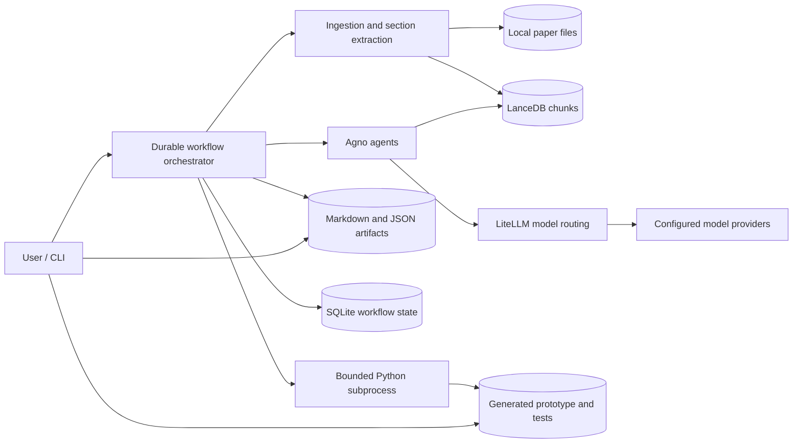
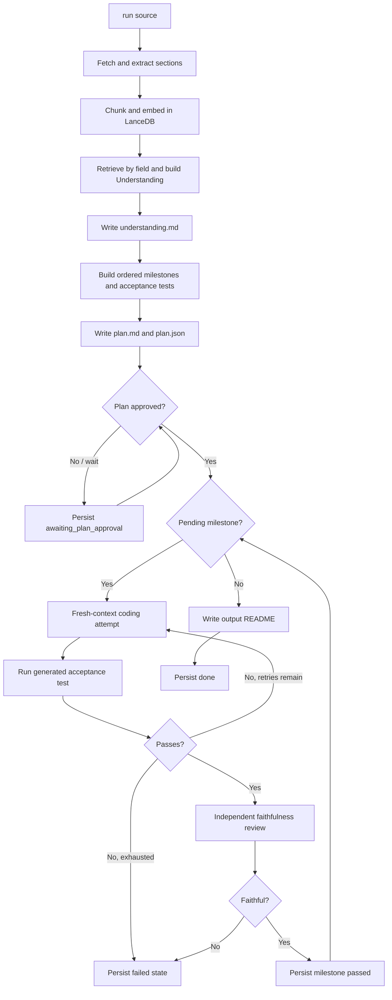

# PaperSmith Architecture

PaperSmith turns a PDF, HTML article, URL, or arXiv identifier into a compact, tested Python reference implementation. It uses local storage for documents, retrieval, artifacts, workflow state, and generated code. LLM calls are made through Agno agents backed by LiteLLM.

## Design goals

- Produce a small, readable prototype rather than reproduce benchmark-scale results.
- Retrieve relevant paper sections instead of copying the entire document into every prompt.
- Pass validated artifacts between stages instead of passing chat transcripts.
- Require human approval before code generation.
- Bound model spending, generated-code execution time, and coding retries.
- Resume interrupted work from persisted stage and milestone checkpoints.

## High-level architecture



## Workflow



## Components

### Ingestion and retrieval

`papersmith.tools.ingest` accepts local PDF/HTML files, HTTP URLs, arXiv URLs, and arXiv identifiers. Raw inputs are copied to `data/papers/<run_id>/`. PDF headings are inferred from typography and numbering; HTML is split on `h1` through `h3` headings.

Sections are divided into overlapping chunks and stored in `data/vectorstore/<run_id>/paper_chunks`. The default `LocalHashEmbedder` is deterministic, private, and requires no embedding API. The comprehension agent receives only a read-only search function over this table.

### Structured agents

All agent handoffs use Pydantic models:

- `Understanding` captures the problem, method, algorithm, equations, architecture notes, and a toy example.
- `Plan` contains ordered `Milestone` objects with interfaces, dependencies, and acceptance tests.
- `CodeBundle` contains complete replacement implementation and test files.
- `Verdict` captures independent faithfulness status and concrete concerns.

Agno 2.x `output_schema` validates model results before they reach the next stage. Planning and coding use the primary model; comprehension uses the fast model; verification uses the separately configured verifier model.

### Artifact memory

Large information crosses stage boundaries through files, not message history:

```text
data/artifacts/<run_id>/understanding.md
data/artifacts/<run_id>/plan.md
data/artifacts/<run_id>/plan.json
```

Later stages read these artifacts as needed. Workflow state stores only paths, statuses, the accumulated cost, and the last error.

### Fresh-context coding loop

Each coding retry constructs a new Agno agent. Its prompt contains only the milestone, current generated Python files, and the previous execution error. Previous agent messages are discarded. This keeps retry context bounded and makes the latest disk state authoritative.

### Execution boundary

Generated tests run in a subprocess using the project interpreter. Execution has a configured timeout, a working directory restricted to `output/<run_id>/`, a minimal environment, and captured output. This boundary prevents in-process `exec`, but it is not an operating-system security sandbox. Run PaperSmith inside a container or VM when processing untrusted papers or model output.

### Durability and approvals

`PaperSmithWorkflow` persists `PaperSmithState` in `data/papersmith.db` after each meaningful transition and milestone. `resume` skips completed artifacts and milestones. One explicit pause state implements human review:

- `awaiting_plan_approval`

There is no separate delivery-approval pause: once every milestone passes its own test and the independent faithfulness review, the run persists straight to `done` — code generation is already gated by human plan approval, and each milestone is already gated by an automated faithfulness check, so a second manual gate at the end added a click without adding a check.

### Guardrails

- `PAPERSMITH_MAX_RETRIES` bounds coding attempts per milestone.
- `PAPERSMITH_MAX_VERIFY_RETRIES` bounds how many times a milestone is regenerated after failing faithfulness review, feeding the reviewer's concerns back into each retry's prompt.
- `PAPERSMITH_EXEC_TIMEOUT_SECONDS` bounds generated-code execution.
- `PAPERSMITH_MAX_RUN_BUDGET_USD` is checked before and after model-backed stages.
- Agno response metrics are accumulated into the persisted `spend_usd` field.
- Generated filenames and run identifiers are sanitized before filesystem use.
- Comprehension gets retrieval only; coding gets no web or shell tool.

## Storage layout

```text
data/
  papers/<run_id>/             copied raw source
  vectorstore/<run_id>/        LanceDB table
  artifacts/<run_id>/          understanding and plan
  papersmith.db                workflow state and preferences
output/<run_id>/               generated implementation, tests, README
```

## Operational limitations

- Retrieval uses a small local hash embedder; production deployments may benefit from a semantic embedding model.
- Model-provider fallback is configured for the primary model route. Provider credentials and availability remain external dependencies.
- The subprocess boundary limits time and working directory but does not provide kernel-level network or filesystem isolation.
- Quality for real papers depends on the selected models and the human plan review.
