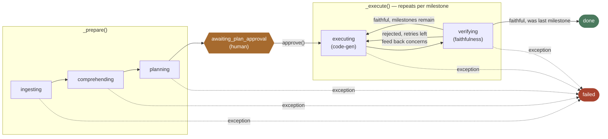
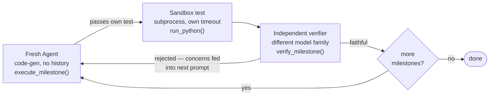
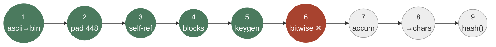

# How PaperSmith Works

A stage-by-stage tour of the durable workflow in [src/papersmith/workflows/pipeline.py](src/papersmith/workflows/pipeline.py) — grounded in a real paper run through ingestion, plus a real interruption-and-resume incident from this project's own history.

**Worked example:** [arXiv:2506.07295v1](https://arxiv.org/pdf/2506.07295v1) — *"Exploring the Impact of Temperature on Large Language Models: Hot or Cold?"*

## The shape of a run

Every run — real or in-progress — is one row in SQLite and a folder of files on disk. Nothing important lives only in memory.

PaperSmith's job is narrow on purpose: take one paper, retrieve what it needs from it rather than re-reading the whole thing every time, and produce a small set of Python functions with tests that a human approved the plan for and an independent model checked for faithfulness. The whole thing is driven by `PaperSmithWorkflow` — a single class with two public entry points that matter here: `start()` and `resume()`. Everything else is that class deciding, from what's already on disk and in the database, how much work is left to do.

The example running through this doc, arXiv:2506.07295, is a 10-page empirical study on how LLM sampling temperature affects benchmark accuracy — not a paper with one clean algorithm, which turns out to be a useful stress test for the ingestion step in particular.

## The state machine

Eight states, one field: `state.status`. Every arrow below is a line in `pipeline.py` that calls `self.store.save(state)` before doing anything else.



`awaiting_plan_approval` is the only state that waits on a person, and it's placed deliberately *before* any code generation — that's the expensive, iterative part. Once a plan is approved, `executing` and `verifying` alternate per milestone with no further human input, ending at `done` or, if a milestone can't be made to pass, `failed`.

## 1. Ingest — `status: ingesting`

Three local, network-light calls in `tools/ingest.py`: `fetch()` downloads or copies the source into `data/papers/<run_id>/`; `extract_sections()` splits the PDF into titled sections using font-size and numbering heuristics; `embed_and_store()` chunks each section (~375 words, slight overlap) and writes them into a per-run LanceDB table with a deterministic local hash embedder — no embedding API call, no cost.

**Real output — arXiv:2506.07295.** This is a two-column PDF with charts and multiple authors, and the heading heuristic is honest about what that does to it: **42 "sections"** instead of the paper's actual ~9. First 15 of 42, real titles:

| Title | Chars | |
|---|---:|---|
| `front_matter` | 160 | |
| `Lujun Li` | 4 | ← author byline split by a superscript affiliation marker |
| `, Lama Sleem` | 1 | ← same |
| `, Niccolo' Gentile` | 10 | ← same |
| `rey Nichil` | 1 | ← same |
| `, Radu State` | 2017 | |
| `1. Introduction` | 3021 | |
| `2. Related Work` | 1744 | |
| `3. Approaches` | 641 | |
| `3.1 Intrinsic Abilities` | 3613 | |
| `Temperature` | 39 | ← chart axis label, bold+large in source |
| `Accuracy` | 2 | ← same |
| `5.1 Statistical Findings` | 2428 | |
| `5.3.1 Best Temp. Selection` | 2255 | |
| `6. Conclusion` | 14479 | |

The bylines get split across several one-character "sections" because the PDF renders each author's superscript affiliation marker as its own text run, and chart axis labels repeat as headings because they're bold and large in the source. This isn't a bug being hidden here — it's the documented tradeoff in `pdf_reader.py`'s docstring: *"pragmatic section-heading heuristics."* It matters less than it looks like it should, because the next stage never trusts section titles for meaning — it searches chunk *content* semantically and uses section metadata only to label results.

*Files: `src/papersmith/tools/ingest.py`, `src/papersmith/tools/pdf_reader.py`*

## 2. Comprehend — `status: comprehending`

An Agno agent (`agents/comprehend.py`) gets exactly one tool: a read-only `search_paper(query, top_k)` function scoped to this run's LanceDB table. Its instructions require separate, targeted searches for six things — problem statement, method, equations, architecture, worked examples, acceptance-test material — rather than one broad "summarize this" query, so retrieval quality doesn't hinge on the section titles being clean.

The output is validated against the `Understanding` Pydantic schema before it's allowed to exist as a file:

| Field | Holds |
|---|---|
| `problem_statement` | precise problem + prior limitations |
| `method_summary` | the proposed method, grounded |
| `key_algorithm` | implementation-ready pseudocode |
| `equations[]` | only ones essential to the method |
| `architecture_notes` | components, shapes, data flow |
| `toy_example` | concrete input/output for testing |

For 2506.07295 specifically — an empirical study, not an algorithm paper — `key_algorithm` and `toy_example` would come back thin or explicitly hedged ("not fully specified by the paper"), because the schema is validated for shape, not for the paper actually containing a tidy algorithm. That honesty propagates: a vague `key_algorithm` produces a vague plan next, not a fabricated one.

> **Guardrail:** a hard 12-call tool limit, plus a 180s wall-clock cap around the whole agent run (`PAPERSMITH_COMPREHEND_TIMEOUT_SECONDS`) — added after a weaker model was observed re-issuing near-duplicate searches indefinitely once past the tool-call limit. See `_run_with_timeout()`.

*Files: `src/papersmith/agents/comprehend.py`, `src/papersmith/schemas/understanding.py`*

## 3. Plan — `status: planning`

`agents/plan.py` reads `understanding.md` — the compressed artifact, not the vector store — and asks the primary model for an ordered list of small milestones, each with an exact function signature and a concrete, deterministic acceptance test (an input and an expected value, shape, or invariant). The instructions explicitly forbid "implement the whole paper" as one milestone and ask for two or three small ones over one broad one.

Each milestone is validated as part of a `Plan`, and `make_plan()` additionally checks that milestone names are unique and that `depends_on` only references milestones that appear earlier — a plan that references a milestone not yet defined is rejected before it ever reaches code generation.

*Files: `src/papersmith/agents/plan.py`, `src/papersmith/schemas/plan.py`*

## 4. Human gate — `status: awaiting_plan_approval`

The run stops here — genuinely stops, no polling, no background work — until `approve(run_id)` is called from the CLI or the Streamlit UI. This is the one point in the whole pipeline where a person reads `plan.md` and `understanding.md` before any code gets written. It sits here rather than at the end because code generation is the expensive, retried, iterative part of a run; catching a misread paper before that starts is cheap, catching it after is not.

*`PaperSmithWorkflow.approve()`, `pipeline.py:87`*

## 5. Execute + verify, one milestone at a time — `status: executing` / `verifying`

This is where most of a run's wall-clock time goes, and it's the one part of the codebase that deliberately avoids growing a conversation. `execute_milestone()` builds a **brand-new** Agno agent on every attempt — no chat history carries over. The only things that persist between attempts are on disk: the current `prototype.py`, and whatever the previous attempt's execution result was.



The retry loop isn't blind: a rejected milestone's specific `concerns` list (e.g. *"the code silently truncates the factorial instead of addressing the paper's ambiguity"*) is rendered into the *next* fresh agent's prompt as a dedicated section, so retry N+1 knows exactly what retry N was told was wrong.

Two independent bars have to be cleared, by design, using two different models: the coding model (`primary()`) writes `prototype.py` and a standalone test; if that test fails, `execute_milestone` retries up to `PAPERSMITH_MAX_RETRIES` times using only the previous stdout/stderr as feedback. Once a test passes, a *separate* model (`verifier()`, deliberately a different provider family) reads the paper's understanding and the code and judges faithfulness — passing your own test proves the code runs, not that it implements what the paper actually said.

*Files: `src/papersmith/agents/code.py`, `src/papersmith/agents/verify.py`, `pipeline.py:141-210`*

---

## What makes it durable

Durability here means one specific thing: a crashed or interrupted process loses at most the work it hadn't yet checkpointed — never more.

Two disciplines make that true, and neither is exotic:

**1. State is saved before and after every stage transition, not just at the end.** Look at the pattern throughout `_prepare()` and `_execute()`: `state.status = "comprehending"; self.store.save(state)` — the write happens *before* the expensive call, so a crash mid-comprehension leaves the state honestly marked `comprehending`, not stuck on a stale earlier status. `StateStore.save()` is a single SQLite `UPSERT`, keyed on `run_id`, keeping only the latest state per run.

| Field | Meaning |
|---|---|
| `run_id` / `source` | identity, never changes |
| `status` | one of the 8 states |
| `vectorstore_path` | set ⇒ ingestion is done |
| `understanding_path` | set ⇒ comprehension is done |
| `plan_path` | set ⇒ planning is done |
| `milestone_statuses` | `{name: pending\|in_progress\|passed\|failed}` |
| `spend_usd` | cumulative, checked every stage |
| `error` | set only when status is `failed` |

`PaperSmithState` is deliberately tiny — paths and statuses, never prose. Read `understanding.md` off disk, don't expect it inline in the state row.

**2. Every stage hands off through a file, never through conversation.** `understanding.md`, `plan.md` / `plan.json`, `prototype.py`, each `test_*.py` — each one is written to disk as soon as it's produced, and the *next* stage reads it fresh from disk rather than being handed it in-memory. This is what makes the state row above sufficient to resume from: the row says which files exist; the files hold everything the row doesn't.

> **Why this matters beyond crash recovery:** it's also why prompts don't grow. The coding agent's prompt on attempt 4 of a milestone is the same size as attempt 1 — milestone spec, current files, last error — never a transcript of attempts 1 through 3.

## How resume actually works

Not a replay log. `resume()` looks at what's already true on disk and in the state row, and re-enters exactly one stage later.

```python
# pipeline.py — the entire routing decision
def resume(self, run_id):
    state = self.store.load(run_id)
    if state.status in {"ingesting", "comprehending", "planning"}:
        return self._prepare(state)      # re-enters _prepare; its own
                                          # if-not-set checks skip finished work
    if state.status in {"executing", "verifying"}:
        return self._execute(state)      # re-enters the milestone loop
    if state.status == "failed":
        # plan_path only exists once planning succeeded —
        # that's what tells resume() which half failed
        return self._execute(state) if state.plan_path else self._prepare(state)
    return state                         # done — nothing to resume
```

The re-entered function does the rest of the work itself. `_prepare()` checks `if not state.vectorstore_path` before ingesting, `if not state.understanding_path` before comprehending, `if not state.plan_path` before planning — each already-populated path short-circuits that block entirely. `_execute()`'s milestone loop opens with `if state.milestone_statuses.get(milestone.name) == "passed": continue` — a passed milestone costs one dictionary lookup on resume, not one LLM call.

### What actually happened, this project, earlier today

A real run against a 9-milestone crypto-hashing paper hit a genuine wall on milestone 5 — the paper never specified which 128 bits to take from a computed factorial, so three feedback-driven retries all got correctly rejected for the same underspecified reason. After manually accepting a reasonable implementation for that one milestone, the run was resumed, got partway into milestone 6, and — deliberately, to check this exact behavior — was killed outright mid-attempt.



*Milestones 1–5: already `"passed"`, `resume()` skips them — zero LLM calls. Milestone 6: killed mid-attempt, no passed status recorded, so it reruns from scratch, fresh agent, unaware anything went wrong the first time.*

Restarting called `resume(run_id)`. Because the saved status was `executing` — not `failed` — `resume()` took the second branch straight into `_execute()`. The loop walked all nine milestones; the first five hit `continue` immediately on the "already passed" check and cost nothing; milestone 6 had no passed status, so it built a fresh agent and ran again, correctly unaware anything had gone wrong the first time — there was nothing in its prompt *to* be aware of. That's the whole mechanism: not a replay, a set of already-true facts the next run doesn't have to re-derive.

The other real failure mode from that same afternoon: a run once failed mid-*comprehension*, before a plan ever existed. There, `resume()`'s `state.plan_path` check correctly routed to `_prepare()` instead of `_execute()` — and inside `_prepare()`, the already-populated `vectorstore_path` skipped re-ingestion, retrying only the comprehension call that had actually failed.

---

## The guardrails, for reference

All configured in `.env`; every one of these exists because something specific went wrong once.

| Variable | Bounds | Default |
|---|---|---:|
| `PAPERSMITH_MAX_RUN_BUDGET_USD` | total spend per run, checked before/after every model call | `2.00` |
| `PAPERSMITH_MAX_RETRIES` | code-gen attempts per milestone (test failures) | `4` |
| `PAPERSMITH_MAX_VERIFY_RETRIES` | regenerations after a rejected faithfulness review | `2` |
| `PAPERSMITH_EXEC_TIMEOUT_SECONDS` | sandboxed test subprocess | `30` |
| `PAPERSMITH_LLM_TIMEOUT_SECONDS` | single LLM request (litellm defaults to 6000s otherwise) | `90` |
| `PAPERSMITH_COMPREHEND_TIMEOUT_SECONDS` | whole comprehension agent run, wall-clock | `180` |
